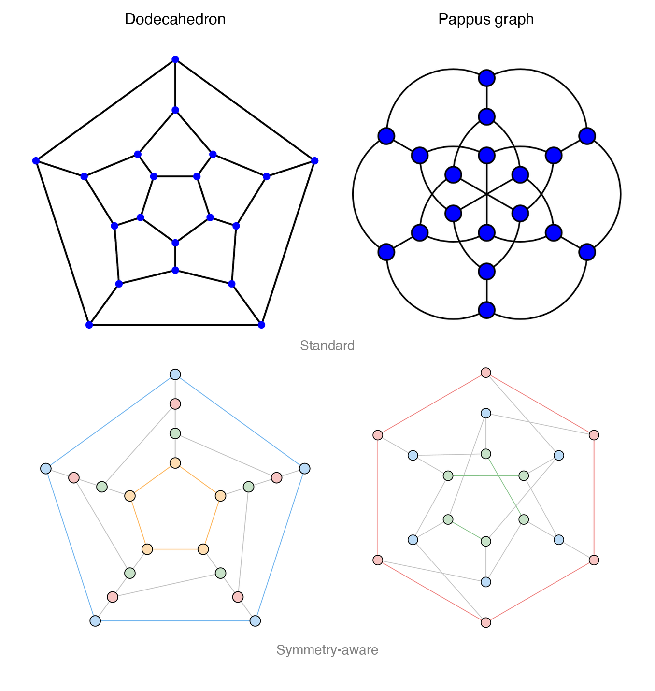

# Symmetric Graph Drawing

Quotient-driven layouts for symmetric graphs, using automorphism group orbits to determine vertex placement on concentric rings with rotational symmetry.

**Pipeline**: GAP computes Aut(Γ) and orbit quotients → Python scores quotients, minimises crossings, places vertices → TikZ renders PDF (or D3.js renders interactive HTML).



## Quickstart

```bash
# Single graph → individual_graphs/auto-dodecahedron.pdf
python3 src/draw_graph.py dodecahedron

# Full gallery → gallery.pdf
python3 src/draw_all.py

# Orbit quotient diagrams → quotients/
python3 src/draw_quotients.py

# Visual catalogue (all individual drawings, one per page) → catalogue.pdf
python3 src/make_catalogue.py
```

Requires [GAP](https://www.gap-system.org/) with the GRAPE package, Python 3, and pdflatex.

## Repository layout

| Directory | Contents |
|-----------|----------|
| `src/` | The pipeline: `draw_graph.py` (layout engine), `draw_all.py` (gallery), `draw_quotients.py`, `symmetric-layout.g` (GAP: Aut, orbits, quotients), `enumerate-quotients.g`, code-construction scripts |
| `src/census/` | Standalone GAP research scripts: PSL(2,q) cubic graph censuses, M₁₁ searches, Macbeath graph, Klein quartic codes |
| `docs/` | [Implementation & theory](docs/SYMMETRIC_EMBEDDING.md), [research program](docs/RESEARCH_PROGRAM.md), [algebraic background](docs/CLASSIFICATION.md), [research notes](docs/RESEARCH_NOTES.md), Eades & Hong reference (`thesis.pdf`) |
| `tex/` | Hand-written papers/diagrams: `cubic-bi-circulant.tex`, Fano plane figures, quotient unfoldings (compile with `pdflatex` from inside `tex/`) |
| `individual_graphs/` | Generated + hand-tuned TikZ drawings of single graphs |
| `quotients/` | Generated orbit-quotient diagrams (output of `draw_quotients.py`) |
| `named_graphs_tikz/` | Curated TikZ sources for named graphs |
| `assets/` | Reference images (downloaded comparisons, JPEG exports) |
| `bolza-surface/` | Genus-2 Bolza surface: cohomology, Poincaré disk tilings, interactive foldings ([docs](bolza-surface/README.md), [maths](bolza-surface/MATHEMATICS.md)) |
| `klein-quartic/` | Genus-3 Klein quartic: PSL(2,7) cohomology, 3D visualization ([notes](klein-quartic/PRELIMINARY.md)) |
| `clayworth/` | CSS quantum codes from graph tilings, Lean 4 formalization ([docs](clayworth/README.md)) |
| `clifford-torus/` | Interactive Clifford torus homotopies ([docs](clifford-torus/README.md)) |
| `surfaces/` | G₂(2) triality hexagon, Clebsch surface ([readme](surfaces/README.md)) |
| `hecke/` | Clebsch surface and three Hecke algebras ([notes](hecke/Clebsch.md)) |
| `lean/` | Lean 4 / mathlib notes and named graph images |

## How it works

1. **GAP** computes Aut(G), enumerates subgroups, finds orbit quotients with low degree
2. **Python** selects the best quotient (by symmetry score), detects cyclic vs cylindrical layout, and places vertices on concentric rings
3. **Crossing minimisation**: path reordering of orbits (Schlegel-like), global angular offset search with rotations and reflections
4. **TikZ** renders the final PDF

For the full theory (Eades & Hong Theorem 3.2, layout modes, adding new graphs), see [docs/SYMMETRIC_EMBEDDING.md](docs/SYMMETRIC_EMBEDDING.md).

## Graphs

All graphs are **cubic** (3-regular). The collection is the complete [Foster census](https://en.wikipedia.org/wiki/Foster_census) of cubic arc-transitive (symmetric) graphs up to 30 vertices — all 13 of them. Cubic graphs are the simplest non-trivial regular graphs, and their automorphism groups are large relative to their size, making them a natural testbed for symmetry-aware drawing.

**The list is exhaustive for n ≤ 30**: every cubic arc-transitive graph on at most 30 vertices appears (there are exactly 13). No cubic arc-transitive graph exists on 12 or 22 vertices.

Given a graph Γ, we compute G = Aut(Γ) and select a subgroup H ≤ G whose orbits give a clean quotient. The layout places each H-orbit on a concentric ring.

| Foster | Graph | n | G = Aut(Γ) | \|G\| | H | \|H\| | Orbits |
|:------:|-------|:-:|------------|:-----:|---|:-----:|--------|
| F004 | K₄ | 4 | S₄ | 24 | C₂ | 2 | [2, 2] |
| F006 | K₃,₃ | 6 | (S₃ × S₃) : C₂ | 72 | C₂ | 2 | [2, 2, 2] |
| F008 | Cube = GP(4,1) | 8 | C₂ × S₄ | 48 | C₄ | 4 | [4, 4] |
| F010 | Petersen = GP(5,2) | 10 | S₅ | 120 | D₁₀ | 10 | [5, 5] |
| F014 | Heawood | 14 | PSL(3,2) : C₂ | 336 | C₂ × C₂ | 4 | [2, 2, 2, 4, 4] |
| F016 | Mobius-Kantor = GP(8,3) | 16 | GL(2,3) : C₂ | 96 | C₈ | 8 | [8, 8] |
| F018 | Pappus | 18 | ((C₃ × C₃) : C₃) : D₈ | 216 | S₃ | 6 | [6, 6, 6] |
| F020A | Dodecahedron | 20 | C₂ × A₅ | 120 | C₅ | 5 | [5, 5, 5, 5] |
| F020B | Desargues = GP(10,3) | 20 | C₂ × S₅ | 240 | C₁₀ | 10 | [10, 10] |
| F024 | Nauru = GP(12,5) | 24 | S₄ × S₃ | 144 | C₁₂ | 12 | [12, 12] |
| F026A | F26A | 26 | C₁₃ : C₆ | 78 | C₁₃ : C₃ | 39 | [13, 13] |
| F028 | Coxeter | 28 | PSL(3,2) : C₂ | 336 | D₁₄ | 14 | [7, 7, 7, 7] |
| F030 | Tutte-Coxeter | 30 | (A₆ . C₂) : C₂ | 1440 | C₁₀ | 10 | [10, 10, 10] |

All group structures computed by GAP (GRAPE package). K₄ and K₃,₃ are included in the code but omitted from the gallery as trivially small. `gallery.pdf` shows the 11 graphs from F008 to F030.

The next entry after F030 is at n=32.

## Going deeper

- **[docs/SYMMETRIC_EMBEDDING.md](docs/SYMMETRIC_EMBEDDING.md)** — implementation: pipeline architecture, graph library, layout modes, how to add a graph
- **[docs/RESEARCH_PROGRAM.md](docs/RESEARCH_PROGRAM.md)** — the research line: Biggs-Smith as "a picture of SU(2) over F₁₇", PSL(2,q) censuses, towers of covers, open questions
- **[docs/CLASSIFICATION.md](docs/CLASSIFICATION.md)** — algebraic background: the GL(2,q) family, PSL(2,q) ≅ SO(3,q), split vs non-split tori
- **[docs/RESEARCH_NOTES.md](docs/RESEARCH_NOTES.md)** — triangle quotient spectra, strong symmetric genus

## Interactive visualizations

### [Square → Torus folding](https://raggedr.github.io/symmetric-graphs/bolza-surface/square_to_torus.html)

Watch a unit square fold into a torus in two phases: rolling into a cylinder (identifying a ↔ a⁻¹), then bending into a torus (identifying b ↔ b⁻¹). Grid lines and colored loops show how the square's coordinate system wraps onto the surface. Drag the slider or hit Play.

### Bolza surface (genus 2)

Cohomology and Poincaré disk tiling of the Bolza surface — the most symmetric genus-2 Riemann surface, with Aut = GL(2,3) of order 48. The (2,3,8) triangle group tiles the hyperbolic plane with 48 fundamental domains per copy of the surface.

- **[Octagon → Torus pipeline](https://raggedr.github.io/symmetric-graphs/bolza-surface/bolza_pipeline.html)** — Full animated pipeline: hyperbolic octagon → Euclidean octagon → cut into two pentagons → deform to cut squares → roll into cylinders → bend into two wounded tori → glue. All 48 (2,3,8) triangles tracked through every transformation. Drag the slider or hit Play.
- **[Hyperbolic octagon explorer](https://raggedr.github.io/symmetric-graphs/bolza-surface/bolza_octagon.html)** — Interactive viewer of the 48 fundamental domain triangles. Press 1-5 to switch between: hyperbolic octagon (geodesic arcs), Euclidean octagon, half-octagon, cut square, wounded torus.
- **[Wounded torus fold](https://raggedr.github.io/symmetric-graphs/bolza-surface/wounded_torus_fold.html)** — Half-octagon deforms into a cut square, then folds into a wounded torus via progressive bending (no self-intersection).
- `bolza-surface/bolza_cohomology.py` — oriented Lefschetz traces, H¹ = V₂ ⊕ V̄₂
- `bolza-surface/bolza_3d.html` — Poincaré disk tiling + 3D genus-2 surface
- `bolza-surface/bolza_disk.pdf` — publication-quality TikZ rendering of the tiling

### Klein quartic (genus 3)

Cohomology of the Klein quartic via dual PSL(2,7) cell decompositions. The (2,3,7) triangle group gives the Hurwitz-maximal automorphism group of order 168.

- `klein-quartic/klein_quartic_cohomology.py` — H¹ = V₃ ⊕ V̄₃, oriented Lefschetz traces
- `klein-quartic/klein_quartic_3d.html` — Poincaré disk tiling + 3D genus-3 surface
- `klein-quartic/verify_cohomology.g` — GAP verification
